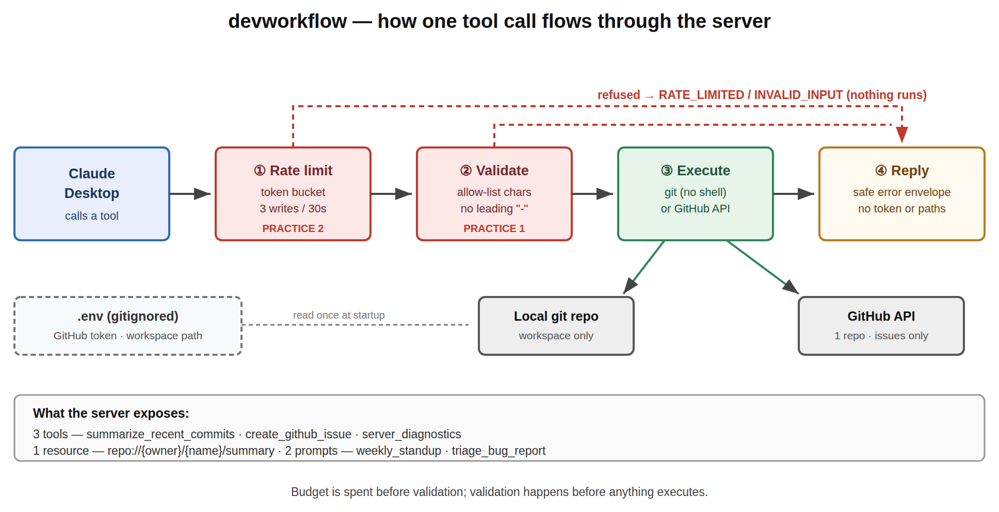

# devworkflow — an MCP server for Development Workflow

**Author: Hamdan Emad Jabr Jaarour** · GitHub: hej80

A local [Model Context Protocol](https://modelcontextprotocol.io/) server that lets Claude Desktop read a
local git repo and file GitHub issues, with **input sanitization** and **rate limiting** on every call. It
exposes 3 tools, 1 resource and 2 prompts over stdio (JSON-RPC), authenticated by a fine-grained GitHub
token loaded from `.env`.

## 1. What the Server Exposes

| Tool | What it does | Network? | Budget |
|---|---|---|---|
| `summarize_recent_commits(repo_path, author, max_count)` | Reads `git log` in a local repo, returns structured commits and a per-author tally | No | 10 / 60 s |
| `create_github_issue(repo, title, body, labels, dry_run)` | Creates a GitHub issue over the authenticated REST API. `dry_run=true` previews and sends nothing | Yes (write) | 3 / 30 s |
| `server_diagnostics(check_github)` | Reports config health, whether GitHub accepts the token, and live budget. Never reveals the token | Optional | 20 / 60 s |

| Prompt / Resource | Purpose |
|---|---|
| `weekly_standup(repo_path, author, days)` | Turns commit history into a Shipped / In progress / Risks / Next step note |
| `triage_bug_report(raw_report, repo)` | Turns a messy bug report into a structured issue, previews it with `dry_run=true`, and requires confirmation before filing |
| `repo://{owner}/{name}/summary` | Read-only repository metadata as Markdown: description, default branch, visibility, language, open issues, stars, last update |

## 2. How a Request Flows



1. **Rate limit** (`ratelimit.py`) — token bucket, one budget per tool
2. **Validate** (`security.py`) — allow-list charsets, no leading `-`, path confined to `WORKSPACE_ROOT`
3. **Execute** — `git_ops.py` (subprocess, `shell=False`) or `github_api.py` (httpx + Bearer token)
4. **Reply** (`errors.py`) — uniform `{ok, error:{code, message}}` envelope, no tracebacks or secrets

**The order is deliberate.** Budget is spent *before* validation, so a runaway loop cannot use the tool as an
unlimited oracle; validation runs before any subprocess or HTTP call, so nothing attacker-influenced reaches `git`.

## 3. Setup

**Prerequisites:** Python 3.10+, `git` on your PATH, [Claude Desktop](https://claude.ai/download), [uv](https://docs.astral.sh/uv/) (`curl -LsSf https://astral.sh/uv/install.sh | sh`).

```bash
git clone https://github.com/hej80/mcp-devworkflow.git && cd mcp-devworkflow
uv venv                          # or: python3 -m venv .venv
source .venv/bin/activate        # Windows: .venv\Scripts\activate
uv pip install -r requirements.txt
cp .env.example .env             # then fill in GITHUB_TOKEN, WORKSPACE_ROOT, ALLOWED_REPOS
mkdir -p ~/mcp-workspace && cd ~/mcp-workspace && git clone https://github.com/hej80/mcp-test.git
```

In VS Code: **Cmd/Ctrl+Shift+P → Python: Select Interpreter → `./.venv/bin/python`**. For the token, go to
[github.com/settings/personal-access-tokens/new](https://github.com/settings/personal-access-tokens/new),
choose **Only select repositories**, set **Issues: Read and write** and a short expiry, and generate — GitHub
shows it once. Fine-grained over classic on purpose: a classic `repo` scope reads and writes **every** repo
you own; this one touches one, and only its issues. `WORKSPACE_ROOT` is a sandbox and `.env` is gitignored. Verify:

```bash
python tests/test_security_and_ratelimit.py   # 14 unit tests
python tests/smoke_test_stdio.py              # starts the server, speaks MCP to it over stdio
```

## 4. Connect to Claude Desktop

Open **Settings → Developer → Edit Config** (macOS `~/Library/Application Support/Claude/claude_desktop_config.json`, Windows `%APPDATA%\Claude\claude_desktop_config.json`) and paste [`claude_desktop_config.json`](claude_desktop_config.json) from this repo, with your own absolute paths:

```json
{ "mcpServers": { "devworkflow": {
    "command": "/Users/hamdanjaarour/mcp-devworkflow/.venv/bin/python",
    "args": ["/Users/hamdanjaarour/mcp-devworkflow/server.py"]
} } }
```

A uv variant is in [`claude_desktop_config.uv.json`](claude_desktop_config.uv.json). Three things break
this for most people: **paths must be absolute** (Claude Desktop does not run your shell, so `python`, `~`
and relative paths do not resolve); **use the venv's interpreter**, or `mcp` is not found; and **no secrets
here** — the file is world-readable plaintext, so the token stays in `.env`. Then **quit Claude Desktop
fully** (Cmd+Q) and reopen.

## 5. The Two Best Practices

### Best Practice #1 — Input Sanitization (`devworkflow/security.py`)

Tool arguments are written by an LLM whose context may hold attacker-controlled text, so they are untrusted
input. `python exploits/exploit_injection.py` first attacks vulnerable code kept inside the exploit file:

| Attack | Vulnerable code | Result |
|---|---|---|
| `"Alice; touch PWNED #"` | `shell=True` | file created — command execution |
| `"--output=/path/PWNED"` | `shell=False` | file created — git writes the file itself |

The second case is the point: **`shell=False` does not stop it** — no shell is involved, git parses the
value as an option. That is argument injection, and only validation stops it. The same nine payloads sent
to the real tool are all refused with `INVALID_INPUT` and create no files (`;`, `$()`, `|`, `--output=`,
`--upload-pack=`, absolute and relative traversal, NUL bytes, oversized input). Five rules do it:
`shell=False` with an argv list; allow-list validation (reject, never escape); no leading `-`; flag and
value as one token (`--author=<value>`); and path confinement resolving symlinks and `..` *before* the
containment check.

### Best Practice #2 — Rate Limiting (`devworkflow/ratelimit.py`)

A model calls tools in a loop; a retry loop or a prompt injection saying "keep trying" turns
`create_github_issue` into an issue-spam bot. The defence is a token bucket per tool — `capacity` tokens
refilling at `capacity / window` per second, writes capped at 3 per 30 s. It allows a short burst while
bounding the long-run average, unlike a fixed-window counter which allows `2N` across a boundary.
`python exploits/exploit_rate_limit.py` fires 8 calls in a row:

```
PART A  without rate limiting : 8/8 writes would reach GitHub
PART B  with rate limiting    : 3 ALLOWED, 5 REFUSED (retry_after=10.0s)
PART C  after waiting 10.4s   : ALLOWED again — a legitimate user is not locked out
PART D  git_read 10/10, github_write 0.04/3, github_read 20/20
```

Part D is why buckets are per tool: a write burst does not starve local reads. **Refusals never leak** —
both guard rails report through one envelope in `errors.py`: expected errors name the rule broken, unexpected
ones return only a random `error_id` with the traceback sent to stderr, and `Settings.redact()` scrubs the token from anything leaving the server.

## 6. Project Structure

```
server.py                     MCP entry point; holds only MCP wiring
devworkflow/security.py       BEST PRACTICE 1 — validation & sanitization
devworkflow/ratelimit.py      BEST PRACTICE 2 — token bucket
devworkflow/{config,errors}.py  dotenv_values + pathlib (no os.environ) · safe error envelope
devworkflow/{git_ops,github_api}.py  subprocess shell=False, minimal env · GitHub REST (httpx)
exploits/ tests/ docs/        attacks · 14 unit tests + stdio client · diagram
claude_desktop_config.json    MCP config (a .uv.json variant is also provided) · .env.example
```

## 7. Code Citations

Every borrowed idea is cited here and again as a comment at the point of use.

| Where | What was used | Source |
|---|---|---|
| `server.py` | FastMCP skeleton: `FastMCP(...)`, `@mcp.tool()` / `@mcp.resource()` / `@mcp.prompt()`, `mcp.run(transport="stdio")` | [python-sdk — Quickstart](https://github.com/modelcontextprotocol/python-sdk#quickstart) |
| `tests/smoke_test_stdio.py` | `stdio_client` + `ClientSession` boilerplate | [python-sdk — Writing MCP Clients](https://github.com/modelcontextprotocol/python-sdk#writing-mcp-clients) |
| `security.resolve_repo_path` | Resolve-then-check containment pattern, re-implemented in Python with `pathlib` (original is TypeScript) | [modelcontextprotocol/servers — filesystem](https://github.com/modelcontextprotocol/servers/tree/main/src/filesystem) |
| `ratelimit.TokenBucket` | Token-bucket algorithm (continuous refill), implemented from the algorithm description | [Token bucket — Wikipedia](https://en.wikipedia.org/wiki/Token_bucket) |
| `github_api.py` | Request headers and the `POST /repos/{owner}/{repo}/issues` contract | [GitHub REST API — Create an issue](https://docs.github.com/en/rest/issues/issues#create-an-issue) |
| `.env` handling | `dotenv_values()` rather than `load_dotenv()`, to keep secrets out of `os.environ` | [python-dotenv docs](https://saurabh-kumar.com/python-dotenv/) |

An AI assistant (Claude) was used during development, as the assignment requires; all code in this repo has been reviewed line by line and can be explained in detail.

## 8. Troubleshooting

| Symptom | Cause and fix |
|---|---|
| Server not listed in Claude Desktop | Paths must be absolute; quit Claude fully (Cmd+Q) and reopen |
| "Server disconnected" | Run `python tests/smoke_test_stdio.py` for the real error. Logs: `~/Library/Logs/Claude/mcp-server-devworkflow.log` |
| `ModuleNotFoundError: mcp` | The config points at the system Python. Use `.venv/bin/python` |
| Every tool fails with a JSON parse error | Something wrote to **stdout**, the JSON-RPC channel. Use the stderr logger in `errors.py`, never `print()`. `AUTH_ERROR`: check `server_diagnostics`. `RATE_LIMITED` or a refused path is the guard rail working as designed |
